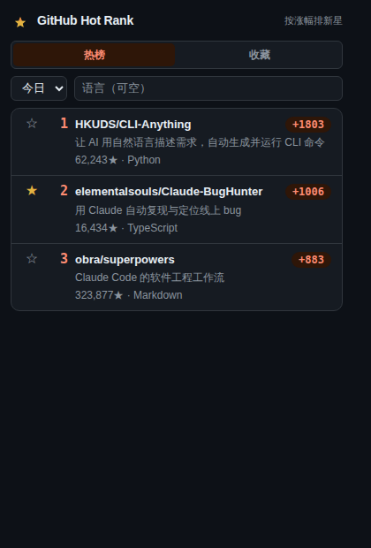

<div align="center">


# GitHub Hot Rank

**按涨幅（而非绝对 star）排 GitHub 新星的浏览器扩展**

[](LICENSE)


</div>

---

Trending 榜按绝对 star 数排名，老牌大仓永远压在前面。**GitHub Hot Rank 用差分增速重新排榜**：今日 +60★ 的 2k★ 新仓，比今日 +20★ 的 200k★ 巨头排得更高——新星就是这样被看见的。

## 界面预览

<p align="center">
  
  
</p>

> 上图为真实 popup 代码在浏览器中渲染的截图（注入演示数据、mock `chrome.storage`），含深浅两套主题；非设计稿。

## 功能

- **涨幅排行**：popup 按 今日 / 本周 / 本月 + 语言过滤渲染 Trending 榜，按增速差分重新排序。
- **仓库页徽章**：浏览任意 GitHub 仓库时，内容脚本注入该仓库当前增速名次徽章。
- **收藏与突变提醒**：收藏仓库后每日快照，涨速突变（Δ1 ≥ 10 且 ≥ 3× 前期日均）时推送通知，每仓每天最多一次。
- **开发期采集工具**：`scripts/` 提供零依赖的每日快照采集与 Δ1 / Δ7 差分，用于本地验证与数据沉淀。增速数据 GitHub 官方已不提供（REST stargazers 时间戳接口 404、GraphQL 无对应字段），只能自建差分。

> ⚠️ logo 候选未定稿：上方图形为候选C「突变尖峰」（盲审两轮后唯一保留候选，评审页见 `brand/review.html`），定稿前不代表最终品牌。

## 版本与发布

- 当前版本：**0.1.0**（Chrome 商店上架候选版）
- 官网：https://hotrank.webkubor.xyz （GitHub Pages，自定义域名）
- 更新日志：[CHANGELOG.md](CHANGELOG.md)
- 上架材料（标题 / 简介 / 权限 justification / 隐私政策）：[docs/store-listing.md](docs/store-listing.md)
- 界面设计规范（tokens 真源）：[DESIGN.md](DESIGN.md)

## 路线图：API 服务 + 薄客户端

插件市场的产品形态是 **API 服务 + 薄客户端扩展**：服务端持续采集 Trending 与追踪仓 star 快照，差分出增速榜与突变事件；扩展只消费榜单，不再各自采集——每个用户本地攒数据没有冷启动可言。当前版本内置的本地采集在服务上线后转为开发期工具。

## 安装（开发者模式）

1. `pnpm install && pnpm build`（或直接用已构建的 `.output/chrome-mv3/`）
2. 打开 `chrome://extensions` → 开启「开发者模式」→「加载已解压的扩展程序」→ 选择 `.output/chrome-mv3/`
3. 工具栏点开 popup 即可用

## 本地跑

```bash
pnpm install && pnpm dev      # 扩展开发
```

## 每日采集（开发期工具 scripts/）

```bash
node scripts/collect.mjs add owner/repo   # 追踪仓库（当前池见 data/tracked.json）
node scripts/collect.mjs                  # 采集今日快照 → data/snapshots/<日期>.json
node scripts/growth.mjs                   # 差分出 Δ1 / Δ7 增速榜
```

- 未认证 60 次/时够日常追踪；池子变大设 `GITHUB_TOKEN` 环境变量（只从环境读取，不落盘）。
- 快照目录不入库（`.gitignore` 的 `data/snapshots/`），数据资产本地沉淀。

## 权限说明

`storage`（快照与收藏）、`alarms`（每日采集）、`notifications`（仅突变提醒）；host 限 `github.com` 与 `api.github.com`。无远程服务，数据不出本机。

License: AGPL-3.0
