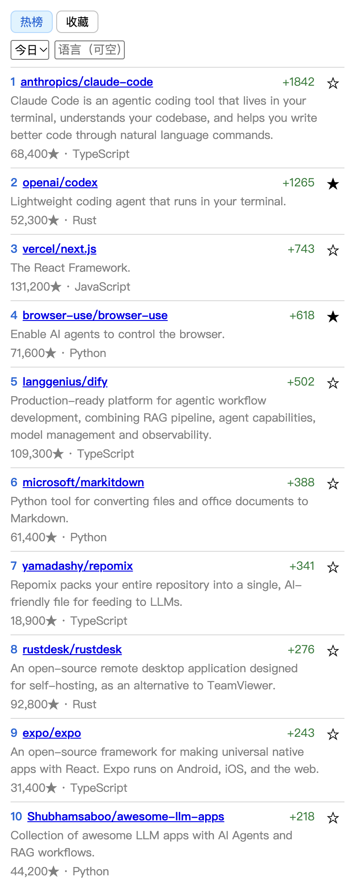

<div align="center">


# GitHub Hot Rank

**按涨幅（而非绝对 star）排 GitHub 新星的浏览器扩展**

[](LICENSE)


</div>

---

Trending 榜按绝对 star 数排名，老牌大仓永远压在前面。**GitHub Hot Rank 用差分增速重新排榜**：今日 +60★ 的 2k★ 新仓，比今日 +20★ 的 200k★ 巨头排得更高——新星就是这样被看见的。

## 界面预览

<p align="center">
  
  
</p>

> 上图为真实 popup 代码在浏览器中渲染的截图（注入演示数据、mock `chrome.storage`），含深浅两套主题；非设计稿。

## 功能

- **涨幅排行**：popup 按 今日 / 本周 / 本月 + 语言过滤渲染 Trending 榜，按增速差分重新排序。
- **仓库页徽章**：浏览任意 GitHub 仓库时，内容脚本注入该仓库当前增速名次徽章。
- **收藏与突变提醒**：收藏仓库后每日快照，涨速突变（Δ1 ≥ 10 且 ≥ 3× 前期日均）时推送通知，每仓每天最多一次。
- **开发期采集工具**：`scripts/` 提供零依赖的每日快照采集与 Δ1 / Δ7 差分，用于本地验证与数据沉淀。增速数据 GitHub 官方已不提供（REST stargazers 时间戳接口 404、GraphQL 无对应字段），只能自建差分。

> ⚠️ logo 候选未定稿：上方图形为候选C「突变尖峰」（盲审两轮后唯一保留候选，评审页见 `brand/review.html`），定稿前不代表最终品牌。

## 版本与发布

- 当前版本：**0.1.0**（Chrome 商店上架候选版）
- 官网：https://hotrank.webkubor.xyz （GitHub Pages，自定义域名）
- 更新日志：[CHANGELOG.md](CHANGELOG.md)
- 上架材料（标题 / 简介 / 权限 justification / 隐私政策）：[docs/store-listing.md](docs/store-listing.md)
- 界面设计规范（tokens 真源）：[DESIGN.md](DESIGN.md)
- 埋点与数据口径（官网统计 / 扩展遥测边界）：[docs/telemetry.md](docs/telemetry.md)

## 架构：API 服务 + 薄客户端

插件市场的产品形态是 **API 服务 + 薄客户端扩展**：服务端持续采集 Trending 与追踪仓 star 快照，差分出增速榜与突变事件；扩展只消费榜单，不再各自采集——每个用户本地攒数据没有冷启动可言。

服务端已实现（`server/`，零外部依赖，Node 22 内置 `node:sqlite`）：

| 文件 | 职责 |
|---|---|
| `server/store.mjs` | 快照库：`snapshots`（按天一行 JSON）/ `repos` / `trending` 三表，UPSERT 幂等 |
| `server/collector.mjs` | 每小时采 Trending HTML + 追踪仓 star，解析后落库 |
| `server/api.mjs` | `GET /health` `/rankings` `/rankings/trending` `/repos/:owner/:name/growth` `/mutations`，无鉴权只读公开 |
| `server/index.mjs` | API + 定时采集同进程（单机起步省一个部署单元） |

共享口径（`shared/growth.mjs`）：服务端与扩展共用同一份 Δ1/Δ7 与突变判定纯函数（Δ1 ≥ 10 且 ≥ 3× 前期日均）。口径若各写一份，服务端说「突变」而扩展说「没突变」时无法排查。

跑服务端：

```bash
node server/index.mjs                # API + 每小时采集（PORT 默认 8787）
node server/index.mjs --collect-once # 只采一轮（给 cron 用）
node server/index.mjs --no-collect   # 只起 API
node --test server/tests/server.test.mjs   # 33 条测试
```

扩展侧走 API：`lib/api.ts` 的 `API_BASE` 默认 `https://api.hotrank.webkubor.xyz/api`（**api. 子域**，不与官网根域名 `hotrank.webkubor.xyz`（GitHub Pages 官网）冲突 —— 一个域名不能同时给 Pages 站点和 API 服务），可用构建期变量 `VITE_HOT_RANK_API` 覆盖（自测指向本机）。拉不到榜单时回退本地直抓 Trending，并在 popup 显式标注「服务端不可用，当前为本地实时抓取」—— 不让用户误以为是官方榜单。

> 服务端尚未对外上线（域名解析未生效），当前发布版本的榜单仍走本地抓取。

## 安装（开发者模式）

1. `pnpm install && pnpm build`（或直接用已构建的 `.output/chrome-mv3/`）
2. 打开 `chrome://extensions` → 开启「开发者模式」→「加载已解压的扩展程序」→ 选择 `.output/chrome-mv3/`
3. 工具栏点开 popup 即可用

## 本地跑

```bash
pnpm install && pnpm dev      # 扩展开发
```

## 每日采集（开发期工具 scripts/）

```bash
node scripts/collect.mjs add owner/repo   # 追踪仓库（当前池见 data/tracked.json）
node scripts/collect.mjs                  # 采集今日快照 → data/snapshots/<日期>.json
node scripts/growth.mjs                   # 差分出 Δ1 / Δ7 增速榜
```

- 未认证 60 次/时够日常追踪；池子变大设 `GITHUB_TOKEN` 环境变量（只从环境读取，不落盘）。
- 快照目录不入库（`.gitignore` 的 `data/snapshots/`），数据资产本地沉淀。

## 权限说明

`storage`（快照与收藏）、`alarms`（每日采集）、`notifications`（仅突变提醒）；host 限 `github.com`、`api.github.com` 与自家榜单 API 域名（`*.webkubor.xyz`，本地自测另有 `localhost`）。

榜单数据经自家 API 获取（公开只读、无鉴权，数据源是公开 GitHub 榜单，聚合后不涉隐私）；`GITHUB_TOKEN` 只在**服务端**从环境读取，不进扩展、不落盘、不进日志。

License: AGPL-3.0
